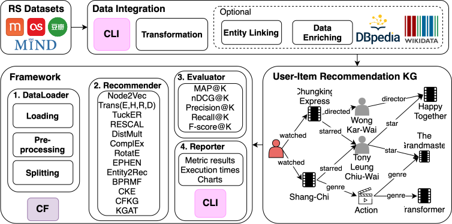

# Introduction

This project is an outcome of [Google Summer of Code 2023](https://summerofcode.withgoogle.com/programs/2023/projects/3NTZTLYb)
project at DBpedia named FranKGraphBench: Framework for ranking Knowledge Graph and reproducible Benchmarking. The Framework was accepted at the Resource Track from the 35th ACM International Conference on Information and Knowledge Management in Rome, Italy from the 7th to 11th November 2026.


This project has three main components:

- **Data Integration**: for loading standard datasets that will be evaluated in the Recommendation task. It also allows enriching them with Knowledge Graphs and related datasets through a map and enrichment interface.
- **Framework**: for running reproducible experiments on enriched and non-enriched datasets through a `.yml` configuration file.
- **Chart Generation**: for visualizing the generated results with full control from the user using a Command-Line Interface.

As part of the Data Integration module we fixed and used the DBpedia 2016-10 core version, accessible through the endpoint [endpoint](https://dbfk25.aksw.org/sparql/) and with .ttl files downloadable [here](https://dbfk25.aksw.org/).




## Half-day online workshop on reproducible recommendation benchmarking with FranKGraphBench

Sign-up now and vote on your prefered dates for participating in an online workshop that will teach you how to create your configuration file and run experiments using FranKGraphBench. Sign up at the [google forms](https://forms.gle/YDZ9t1uPBtgE3cxq8) or by reading the QR Code:


## How to Cite

FranKGraphBench was published under [FranKGraphBench: Reproducible Benchmarking for Knowledge Graph-based Recommendation](https://doi.org/10.1145/3799682.3840189) in CIKM 2026. To cite it use the following bibtex:

```bibtex
@inproceedings{carmo2026FranK,
  author = {Viviurka Do Carmo, Paulo and Lopes, Alvaro Jos{\'e} and Silva G{\^o}lo, Marcos Paulo and Marx, Edgard},
  title = {FranKGraphBench: Reproducible Benchmarking for Knowledge Graph-based Recommendation},
  year = {2026},
  isbn = {9798400725395},
  publisher = {Association for Computing Machinery},
  address = {New York, NY, USA},
  url = {https://doi.org/10.1145/3799682.3840189},
  doi = {10.1145/3799682.3840189},
  booktitle = {Proceedings of the 35th ACM International Conference on Information and Knowledge Management},
  pages = {9024–9029},
  numpages = {6},
  keywords = {knowledge graphs, recommender systems, reproducibility},
  location = {Rome, Italy},
  series = {CIKM '26}
}
```
