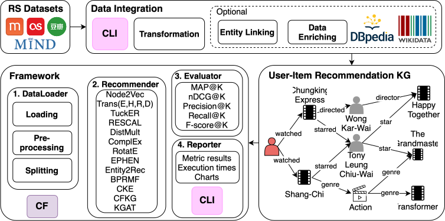

.. Knowledge-Graph-aware-Recommender-Systems-with-DBpedia documentation master file, created by
   sphinx-quickstart on Mon Oct  9 10:24:25 2023.
   You can adapt this file completely to your liking, but it should at least
   contain the root `toctree` directive.

Welcome to FranKGraphbench's documentation!
==================================================================================

This project is an outcome of `Google Summer of Code 2023 <https://summerofcode.withgoogle.com/programs/2023/projects/3NTZTLYb>`_ project at DBpedia, named FranKGraphBench: Framework for ranking Knowledge Graph and reproducible Benchmarking. The Framework was accepted at the Resource Track from the 35th ACM International Conference on Information and Knowledge Management in Rome, Italy from the 7th to 11th November 2026.

This project has three main components:

- **Data Integration**: for loading standard datasets that will be evaluated in the Recommendation task. It also allows enriching them with Knowledge Graphs and related datasets through a map and enrichment interface.
   - As part of the Data Integration module we fixed and used the DBpedia 2016-10 core version, accessible through the endpoint `https://dbfk25.aksw.org/sparql/` and with .ttl files downloadable `https://dbfk25.aksw.org/`.
- **Framework**: for running reproducible experiments on enriched and non-enriched datasets through a `.yml` configuration file.
- **Chart Generation**: for visualizing the generated results with full control from the user using a Command-Line Interface.

.. toctree::
   :maxdepth: 2
   :caption: Getting Started:

   getting_started/intro
   getting_started/quick_start
   getting_started/support
   getting_started/config

.. toctree::
   :maxdepth: 2
   :caption: Contributing:

   contributing/intro
   contributing/add_dataset
   contributing/add_recommender
   contributing/add_metric
   contributing/add_splitting
   contributing/add_preprocess
   contributing/improve_matching
   contributing/bug_fixing

.. toctree::
   :maxdepth: 2
   :caption: Benchmark Results:

   benchmark_results/results

Indices and tables
==================

* :ref:`genindex`
* :ref:`modindex`
* :ref:`search`
